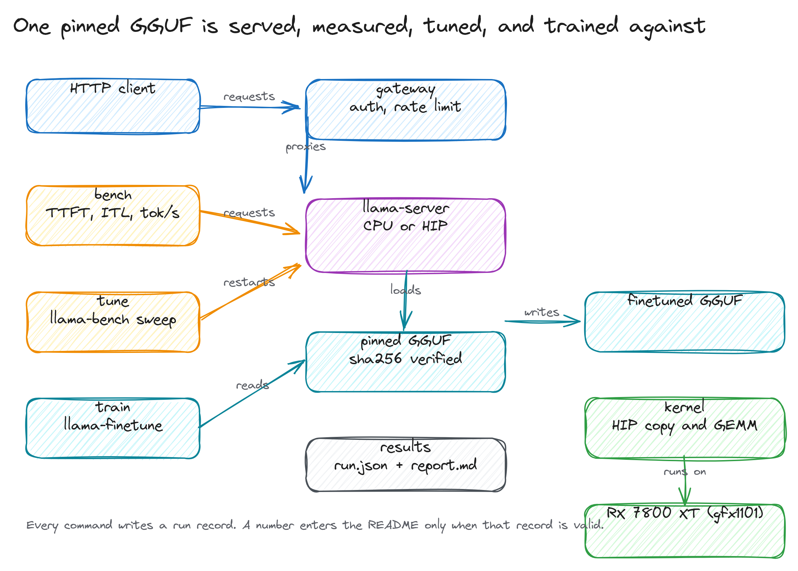
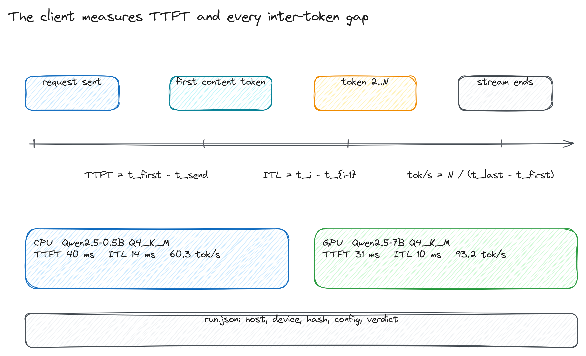
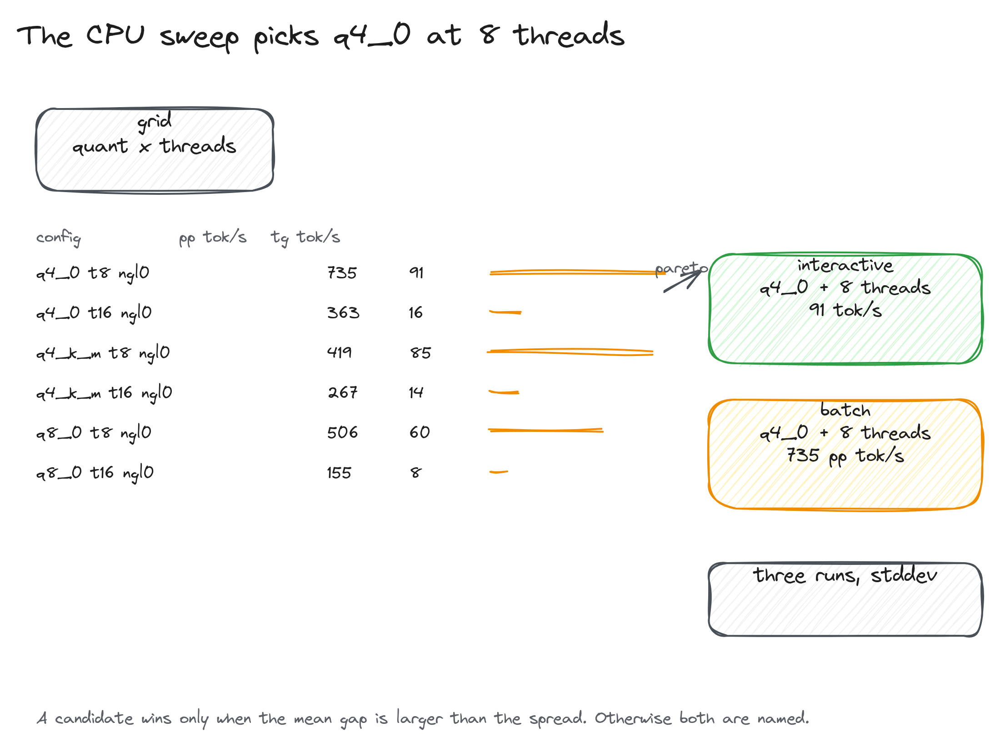

# Blinding

Blinding measures and compares the LLM inference server you already run. It
points at an OpenAI-compatible endpoint or starts a pinned llama.cpp model,
streams requests to measure time to first token and inter-token latency,
profiles the kernels a run launches, and writes a run record with the host,
device, git commit, model hash, config, and a validity verdict. `blinding compare` turns two records into per-level deltas
with bootstrap intervals, and `blinding gate` turns that comparison into a CI
check that fails on a regression you can defend.

It is built for one Linux box: a CPU, and a Radeon GPU when the ROCm image is
available. The numbers in this file come from an AMD Ryzen 7 5700X and a
Radeon RX 7800 XT.

## The loop

```bash
# 1. Measure the server you already have running.
blinding bench --url http://127.0.0.1:8000 --model-name qwen2.5-7b-instruct \
  --concurrency 1 4 8 --requests 32

# 2. Change one thing: engine build, quantisation, driver, or a serving flag.

# 3. Measure again.
blinding bench --url http://127.0.0.1:8000 --model-name qwen2.5-7b-instruct \
  --concurrency 1 4 8 --requests 32

# 4. Ask whether the change made it worse.
blinding compare <baseline-run> <candidate-run>
blinding gate --baseline <baseline-run> --candidate <candidate-run>
```

`compare` prints one row per level and metric: the two values, the relative
change, a bootstrap interval for that change, and a verdict (`regressed`,
`improved`, `unchanged`, or `inconclusive`). A regression counts only when the
whole interval sits beyond the tolerance, so a noisy pair of runs does not
produce a false alarm. `gate` exits 0 for a pass, 1 for a regression, and 3
when the evidence is invalid or the runs are not comparable.

## Install

Blinding needs Python 3.12 or newer. There is no PyPI release yet; install from
a checkout.

```bash
git clone https://github.com/meillaya/blinding
cd blinding
uv sync
uv run blinding --help
```

The repository also ships two development environments that evaluate the same
`devenv.nix`:

```bash
devenv shell            # devenv CLI, the primary path
nix develop --impure    # flake entry point for an existing flake workflow
```

Both provide Python 3.12, uv, git, make, curl, and podman. The flake path
needs `--impure` because devenv reads the working directory from the
environment; add `--accept-flake-config` to use the pinned binary cache. The llama.cpp build,
the ROCm userspace, and the HIP kernel benchmark live in the container images
under `sandbox/`, because a measurement run should happen in a known image.
`devenv.lock` and `flake.lock` pin the Nix inputs; regenerate both after
changing an input (`devenv update`, `nix flake update`).

## Point at a server that is already running

This is the adoption path: no manifest entry, no local llama.cpp install, no
model download. `--model-name` is the model id the server expects in the
request body. If the server lists a single model at `/v1/models` and
`--model-name` is omitted, Blinding uses that id.

```bash
blinding bench --url http://127.0.0.1:8000 --model-name qwen2.5-7b-instruct \
  --concurrency 1 4 8 --requests 32 --prompt-tokens 1024 --max-tokens 256
```

Set `BLINDING_API_KEY` when the endpoint needs a key. The run record keeps the
base URL and redacts the key. `eval --url` scores the prompt suite against the
same kind of endpoint.

If the server has no `/tokenize` endpoint, Blinding measures the prompt length
with one non-streamed request and records how it got the number in
`workload.prompt_tokens_source`. Servers that reject `stream_options` are
retried once without it.

## Measure a pinned local model

The sandbox keeps every file it creates inside this checkout. It builds a
llama.cpp image at the pinned commit, puts the podman store and the model cache
under `.sandbox/`, and runs the container with a read-only root.

```bash
scripts/sandbox.sh init
scripts/sandbox.sh build --cpu
scripts/sandbox.sh run --cpu uv sync
scripts/sandbox.sh run --cpu uv run blinding doctor
scripts/sandbox.sh run --cpu uv run blinding models pull qwen2.5-0.5b-instruct:q4_k_m
scripts/sandbox.sh run --cpu uv run blinding bench qwen2.5-0.5b-instruct:q4_k_m \
  --config configs/local-cpu.toml --threads 8
```

`scripts/sandbox.sh clean` removes the store, images, containers, and caches.
If Python 3.12, uv, and llama.cpp are already on the machine, `uv sync` and
`uv run blinding ...` work without the container. The model cache then defaults
to `~/.cache/blinding`.

For the GPU, build the ROCm image and use the HIP config:

```bash
scripts/sandbox.sh build --rocm
scripts/sandbox.sh run --rocm uv run blinding bench qwen2.5-7b-instruct:q4_k_m \
  --config configs/local-rocm.toml --parallel 4
```



## What the commands do

| command | job |
|---|---|
| `bench` | Start or attach to a server, send streamed requests at each concurrency level, and record TTFT, inter-token latency, decode throughput, per-request samples, and errors. |
| `compare` | Read two bench records and report per-level metric deltas with bootstrap intervals and verdicts. |
| `gate` | Run `compare` as a check: fail on a regression, unusable evidence, or an unintended host change. |
| `doctor` | Print the CPU, memory, kernel, llama.cpp binaries, and the devices llama.cpp reports. |
| `models` | List, pull, and verify the pinned models by revision and SHA-256. |
| `serve` | Run `llama-server` in the foreground, with an optional API-key gateway in front. |
| `tune` | Sweep `llama-bench` over quants, thread counts, and GPU layers and name a Pareto config. |
| `eval` | Score the prompt suite at temperature zero with a Wilson interval on the pass rate. |
| `kernel` | Run the HIP copy and rocBLAS GEMM benchmark in the ROCm image, with per-iteration samples, source-level copy variants, autotune, roofline percentages, and an optional rocprofv3 kernel breakdown. |
| `train` | Fine-tune the small F32 test model and measure perplexity before and after. |
| `profile` | Run llama-bench inference under rocprofv3 and record the kernel-time breakdown for a pinned model. |
| `results` | List and show recorded runs. |

Every command writes `results/<run-id>/run.json` and a human report. A
benchmark with more than 5% errors or fewer than eight successful requests per
level is marked invalid and its metrics do not enter a summary table.

## How the client measures



The client records the send time, the arrival time of every content chunk, and
the stream end. TTFT is the first content chunk minus the send. An inter-token
gap is one chunk arrival minus the previous one. Decode throughput is completed
tokens divided by wall time for the level.

The prompt is repeated seed text, tokenized by the server, so the prompt length
is measured rather than estimated. A request that ends without content or
without `[DONE]` is an error, not a zero.

`compare` resamples the per-request samples the benchmark wrote. TTFT
percentiles resample requests; inter-token percentiles resample whole requests
and pool their gaps, because gaps inside one request are not independent. The
default is 2000 resamples at 95% confidence with a fixed seed, so the same
records produce the same intervals.

## Measured on this machine

Host: AMD Ryzen 7 5700X, 16 threads, 62 GiB, Linux 7.3.3. GPU: Radeon RX 7800 XT,
gfx1101, 16 GiB. llama.cpp build `b29c606` (`b10964`). ROCm 7.2.4. Run ids point
at `results/<run-id>/run.json`.

### CPU, Qwen2.5-0.5B Q4_K_M

| run | threads | concurrency | TTFT p50 | TTFT p95 | ITL p50 | decode tok/s | errors |
|---|---|---|---|---|---|---|---|
| 20261110T231626Z | 8 | 1 | 39.5 ms | 93.9 ms | 13.8 ms | 60.3 | 0.00% |
| 20261110T231626Z | 8 | 2 | 1761.4 ms | 1790.9 ms | 13.3 ms | 73.6 | 0.00% |
| 20261110T231626Z | 8 | 4 | 4940.6 ms | 5053.9 ms | 12.7 ms | 77.2 | 0.00% |
| 20261110T231720Z | 16 | 1 | 56.1 ms | 159.2 ms | 31.2 ms | 16.8 | 0.00% |
| 20261110T231720Z | 16 | 2 | 7694.9 ms | 39162.2 ms | 30.9 ms | 8.9 | 0.00% |
| 20261110T231720Z | 16 | 4 | 34001.3 ms | 76136.3 ms | 34.8 ms | 7.6 | 0.00% |

The server uses one slot, so requests above concurrency one queue and TTFT
grows. Sixteen threads are slower than eight on this chip. The extra hardware
threads contend for the same cores and the scheduler spends more time moving
work than doing it. `configs/local-cpu.toml` uses eight threads.

### GPU, Qwen2.5-7B Q4_K_M, four slots

| run | concurrency | TTFT p50 | TTFT p95 | ITL p50 | decode tok/s | errors |
|---|---|---|---|---|---|---|
| 20261110T232623Z | 1 | 31.3 ms | 35.4 ms | 10.5 ms | 93.2 | 0.00% |
| 20261110T232623Z | 2 | 44.3 ms | 151.6 ms | 12.6 ms | 150.1 | 0.00% |
| 20261110T232623Z | 4 | 147.1 ms | 245.8 ms | 18.3 ms | 205.6 | 0.00% |
| 20261110T232623Z | 8 | 1287.9 ms | 2482.2 ms | 18.3 ms | 210.9 | 0.00% |

Four slots turn a 7B model into a server that holds TTFT under 250 ms up to
four requests in flight and reaches 205 tok/s aggregate. Eight requests queue
behind the four slots and TTFT grows to 1.3 s while aggregate throughput barely
moves.

The pinned build does not print its offload count in the server log, so the run
records the ROCm device and the measured throughput rather than a layer count
copied from a config. `llama-server --list-devices` reports the RX 7800 XT.

## Tuning

The CPU sweep ran six configurations with `llama-bench`, three repetitions
each (run `20261110T232306Z`). `tg` is the raw generation loop; it is higher than
the HTTP decode number because it excludes the server path.

| quant | threads | pp tok/s | tg tok/s | file size |
|---|---|---|---|---|
| q4_0 | 8 | 734.8 | 91.0 | 0.39 GiB |
| q4_0 | 16 | 363.4 | 15.6 | 0.39 GiB |
| q4_k_m | 8 | 418.9 | 85.2 | 0.45 GiB |
| q4_k_m | 16 | 266.7 | 13.8 | 0.45 GiB |
| q8_0 | 8 | 506.2 | 59.7 | 0.62 GiB |
| q8_0 | 16 | 155.0 | 7.9 | 0.62 GiB |



The GPU sweep used the same three quantisations with 99 GPU layers requested
(run `20261110T232709Z`):

| quant | threads | ngl | pp tok/s | tg tok/s | file size |
|---|---|---|---|---|---|
| q4_0 | 8 | 99 | 12414.0 | 302.4 | 0.39 GiB |
| q4_k_m | 8 | 99 | 10923.3 | 291.5 | 0.45 GiB |
| q8_0 | 8 | 99 | 11602.8 | 291.9 | 0.62 GiB |

On the GPU the quant choice barely moves throughput. At this size the decode
step is not limited by reading the weights. The CPU result is the opposite:
q4_0 at eight threads is the clear pick.

## Kernels

The HIP copy kernel moves 256 MiB per timed iteration. rocBLAS GEMM runs three
warmups and seven timed iterations per point. The table keeps a few representative shapes
and shows the copy blocks.

| kernel | shape | result |
|---|---|---|
| copy | block 128 | 325.2 GB/s |
| copy | block 256 | 465.9 GB/s |
| copy | block 512 | 462.0 GB/s |
| copy | block 1024 | 457.8 GB/s |
| gemm fp16 | 4096 nn | 58,976.8 GFLOPS |
| gemm fp16 | 2048 nt | 51,993.6 GFLOPS |
| gemm fp32 | 4096 nt | 12,893.1 GFLOPS |
| gemm fp32 | 2048 nt | 11,672.9 GFLOPS |

The full 20-point table is in `results/20261110T232718Z-kernel-hip/report.md`.
The copy kernel peaks at 466 GB/s with 256-thread blocks. The kernel command
measures that copy kernel and the GEMM kernels the rocBLAS library selects for
each shape. Source-level kernel autotuning of the GEMM path is not implemented;
the copy kernel has a variant sweep, described below.

### Kernel evidence

The kernel command writes schema 2: every copy and GEMM row carries the seven
per-iteration samples behind its mean, so `compare` can say whether a kernel
change is real instead of comparing two single-number runs.

Copy rows can name a source variant with `--copy-variants vec4-i2-w2`, where
the numbers are floats per vector, items per thread, and waves per compute
unit. `--autotune-copy` sweeps all 18 combinations over the configured block
sizes and reports the best variant per block, with a clock pre-warm so the
winner is not simply the variant measured last. Each variant is checked
against the source buffer before it is timed.

`configs/rocm-peaks.toml` carries the gfx1101 peaks, so each row reports its
percent of peak bandwidth or throughput next to the raw rate. The peaks are
624 GB/s, 37.3 TFLOPS fp32, and 74.6 TFLOPS fp16.

`blinding profile <model>:<quant> --config configs/local-rocm.toml` runs
llama-bench inference for a pinned model under rocprofv3 and records where the
kernel time went, as calls, total seconds, and share per kernel. The trace
files stay under the run directory but are git-ignored, because a full trace
is local debugging material, not repository content. `blinding kernel
--profile` does the same for the HIP benchmark.

## Training and evaluation

The tiny F32 model fine-tuned on 52 KB of Aesop for one epoch (run
`20261110T232609Z`). Perplexity on the held-out text fell from 61.114 to 38.548
in 5.1 s. That proves the harness, not the quality of a model. The same command
accepts any F32 GGUF the machine can hold.

The 16-prompt suite scored 10 of 16 on Qwen2.5-0.5B (62.5%, Wilson 38.6% to
81.5%, run `20261110T232302Z`) and 15 of 16 on Qwen2.5-7B (93.8%, Wilson 71.7%
to 98.9%, run `20261110T232701Z`). The suite is small and strict about format; a
fenced JSON answer fails the JSON check.

## Serving behind a key

```bash
export BLINDING_API_KEYS=local-key
uv run blinding serve qwen2.5-0.5b-instruct:q4_k_m \
  --config configs/local-cpu.toml --gateway --gateway-port 8080
```

The gateway answers `GET /healthz` and `GET /metrics` without a key. Everything
else needs `X-API-Key`. A missing or wrong key returns 401, a burst over the
token bucket returns 429 with `Retry-After`, and an unreachable upstream returns
502 or 504. In the tested run (`20261110T232852Z`), `/healthz` returned 200, `/v1/models`
returned 401 without a key and 200 with one, and a chat completion returned 200. A
SIGTERM to the CLI stopped the gateway and the server and wrote the run record.

## Limits

The numbers are one host on one day. Load average is in every run record, but
the tables are a snapshot, not an SLO.

A single pair of runs carries request sampling noise but not run-to-run host
drift. The intervals say how much the request sample moved, not how much the
machine moved between runs. Treat `inconclusive` as "run it again with more
requests", and compare runs that share a host and device.

The CPU benchmark uses one server slot, so concurrency shows queueing rather
than parallel decode. The GPU benchmark uses four slots.

The endpoint mode measures the server you point at; it does not configure it,
so the engine flags and versions are whatever that server runs. The run record
says that with `model.source: endpoint` and a null config.

No cloud deployment is measured or claimed. The old InferenceOps platform and
its AWS layer were removed; the audit in the repository records the evidence.

Fine-tuning uses llama.cpp's work-in-progress example and a 1.2 MB model. It
does not train a useful model, and GPU fine-tuning is not measured.

The first copy measurement in a fresh process can read below the steady state
until the card's memory clock ramps. `--autotune-copy` pre-warms for that
reason; take kernel numbers from a warm run and treat the per-iteration
samples, not a single peak, as the evidence.

The GPU requires ROCm and the podman device pass-through. Without them the tool
reports CPU only. The sandbox passes `/dev/kfd` and the render node and nothing
else. Profiling needs `rocprofv3` from the ROCm image, and the walk of a real
inference trace needs the model to fit in 16 GiB; the 0.5B quantisation does.

## Development

```bash
make check          # lint, typecheck, tests, prose
make figures        # regenerate the Excalidraw scenes and PNGs
make sandbox-check  # run every gate inside the CPU image
```

`tools/check_prose.py` is the mechanical prose gate. The repository history is
in `AUDIT.md`, which records why the old demo platform was replaced and how the
current claims are checked.

## License

MIT. See `LICENSE`.
