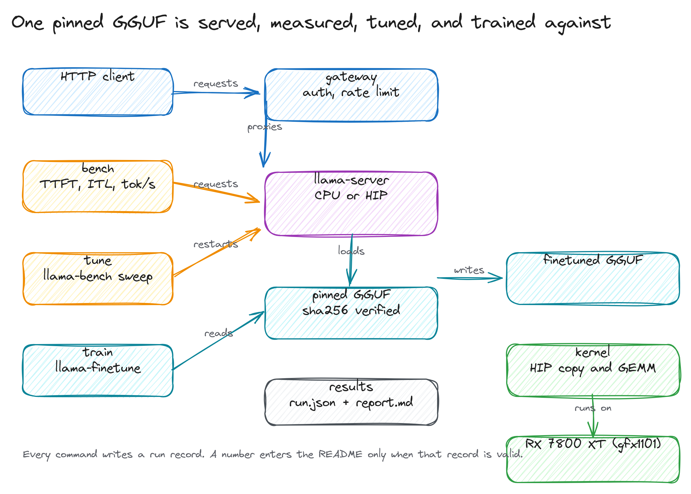
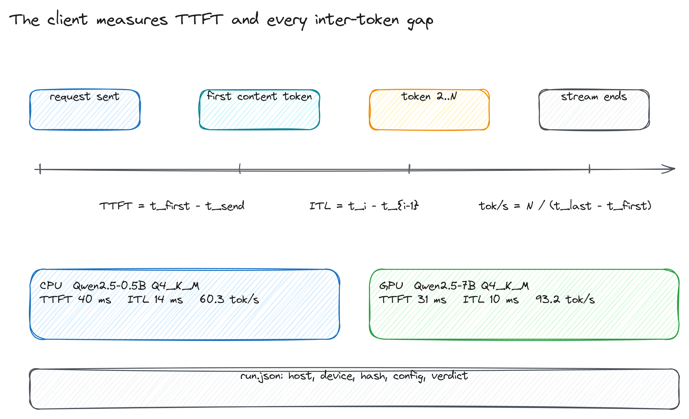
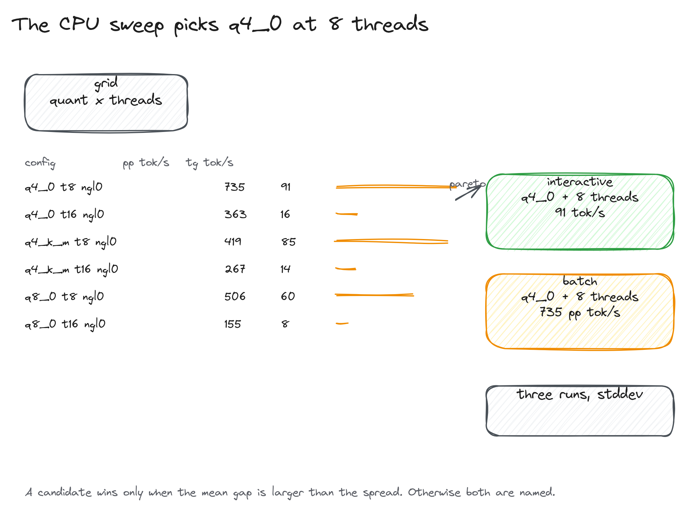

# Blinding

Blinding measures a llama.cpp server on the machine you own. It pins a GGUF by
commit and SHA-256, serves it on the CPU or a ROCm build, streams requests to
measure time to first token and inter-token latency, sweeps llama.cpp flags with
`llama-bench`, measures a HIP copy kernel and rocBLAS GEMM, scores a small prompt
suite, and fine-tunes the 1.2 MB test model.

Every command writes `results/<run-id>/run.json` with the host, device, git
commit, model hash, config, and a validity verdict. The tables below are copied
from those records.

It is for one Linux box with a CPU and, if you have one, a Radeon GPU. The
numbers here come from an AMD Ryzen 7 5700X and a Radeon RX 7800 XT.

## First run

The sandbox keeps every file it creates inside this checkout. It builds a
llama.cpp image at the pinned commit, puts the podman store and the model cache
under `.sandbox/`, and runs the container with a read-only root.

```bash
scripts/sandbox.sh init
scripts/sandbox.sh build --cpu
scripts/sandbox.sh run --cpu uv sync
scripts/sandbox.sh run --cpu uv run blinding doctor
scripts/sandbox.sh run --cpu uv run blinding models pull qwen2.5-0.5b-instruct:q4_k_m
scripts/sandbox.sh run --cpu uv run blinding bench qwen2.5-0.5b-instruct:q4_k_m \
  --config configs/local-cpu.toml --threads 8
```

`scripts/sandbox.sh clean` removes the store, images, containers, and caches.
If Python 3.12, uv, and llama.cpp are already on the machine, `uv sync` and
`uv run blinding ...` work without the container. The model cache then defaults
to `~/.cache/blinding`.

For the GPU, build the ROCm image and use the HIP config:

```bash
scripts/sandbox.sh build --rocm
scripts/sandbox.sh run --rocm uv run blinding bench qwen2.5-7b-instruct:q4_k_m \
  --config configs/local-rocm.toml --parallel 4
```



## What the commands do

`blinding doctor` prints the CPU, memory, kernel, llama.cpp binaries, and the
devices llama.cpp reports. It exits non-zero when a required binary is missing.

`blinding models pull <model>:<quant>` downloads the pinned shards, checks size
and SHA-256 while streaming, and links split shards into one directory so
llama.cpp can find them. `models verify` re-checks a cached copy.

`blinding serve <model>:<quant>` runs `llama-server` with a config. `--gateway`
starts the API gateway in front with an API key, a per-key token bucket, and
Prometheus metrics.

`blinding bench` starts a server on a free port, sends a fixed number of
streamed requests at each concurrency level, and reports TTFT, inter-token
latency, decode throughput, and errors. A run with more than 5% errors or fewer
than eight successful requests per level is marked invalid and does not enter a
summary table.

`blinding tune` runs `llama-bench` over quants, thread counts, and GPU layers.
It writes a Pareto set and names a config only when the mean gap is larger than
the standard deviation.

`blinding kernel` runs the HIP copy kernel and rocBLAS GEMM benchmark in the
ROCm image.

`blinding eval` sends the prompt suite at temperature zero and scores exact,
regex, JSON, and contains checks. It reports the pass count with a Wilson
interval.

`blinding train` runs `llama-finetune` on an F32 GGUF and a text corpus, then
measures perplexity before and after on held-out text.

## How the client measures



The client records the send time, the arrival time of every content chunk, and
the stream end. TTFT is the first content chunk minus the send. An inter-token
gap is one chunk arrival minus the previous one. Decode throughput is completed
tokens divided by wall time for the level.

The prompt is repeated seed text, tokenized by the server, so the prompt length
is measured rather than estimated. A request that ends without content or
without `[DONE]` is an error, not a zero.

## Measured on this machine

Host: AMD Ryzen 7 5700X, 16 threads, 62 GiB, Linux 7.3.3. GPU: Radeon RX 7800 XT,
gfx1101, 16 GiB. llama.cpp build `b29c606` (`b10964`). ROCm 7.2.4. Run ids point
at `results/<run-id>/run.json`.

### CPU, Qwen2.5-0.5B Q4_K_M

| run | threads | concurrency | TTFT p50 | TTFT p95 | ITL p50 | decode tok/s | errors |
|---|---|---|---|---|---|---|---|
| 20261110T231626Z | 8 | 1 | 39.5 ms | 93.9 ms | 13.8 ms | 60.3 | 0.00% |
| 20261110T231626Z | 8 | 2 | 1761.4 ms | 1790.9 ms | 13.3 ms | 73.6 | 0.00% |
| 20261110T231626Z | 8 | 4 | 4940.6 ms | 5053.9 ms | 12.7 ms | 77.2 | 0.00% |
| 20261110T231720Z | 16 | 1 | 56.1 ms | 159.2 ms | 31.2 ms | 16.8 | 0.00% |
| 20261110T231720Z | 16 | 2 | 7694.9 ms | 39162.2 ms | 30.9 ms | 8.9 | 0.00% |
| 20261110T231720Z | 16 | 4 | 34001.3 ms | 76136.3 ms | 34.8 ms | 7.6 | 0.00% |

The server uses one slot, so requests above concurrency one queue and TTFT
grows. Sixteen threads are slower than eight on this chip. The extra hardware
threads contend for the same cores and the scheduler spends more time moving
work than doing it. `configs/local-cpu.toml` uses eight threads.

### GPU, Qwen2.5-7B Q4_K_M, four slots

| run | concurrency | TTFT p50 | TTFT p95 | ITL p50 | decode tok/s | errors |
|---|---|---|---|---|---|---|
| 20261110T232623Z | 1 | 31.3 ms | 35.4 ms | 10.5 ms | 93.2 | 0.00% |
| 20261110T232623Z | 2 | 44.3 ms | 151.6 ms | 12.6 ms | 150.1 | 0.00% |
| 20261110T232623Z | 4 | 147.1 ms | 245.8 ms | 18.3 ms | 205.6 | 0.00% |
| 20261110T232623Z | 8 | 1287.9 ms | 2482.2 ms | 18.3 ms | 210.9 | 0.00% |

Four slots turn a 7B model into a server that holds TTFT under 250 ms up to
four requests in flight and reaches 205 tok/s aggregate. Eight requests queue
behind the four slots and TTFT grows to 1.3 s while aggregate throughput barely
moves.

The pinned build does not print its offload count in the server log, so the run
records the ROCm device and the measured throughput rather than a layer count
copied from a config. `llama-server --list-devices` reports the RX 7800 XT.

## Tuning

The CPU sweep ran six configurations with `llama-bench`, three repetitions
each (run `20261110T232306Z`). `tg` is the raw generation loop; it is higher than the HTTP decode number
because it excludes the server path.

| quant | threads | pp tok/s | tg tok/s | file size |
|---|---|---|---|---|
| q4_0 | 8 | 734.8 | 91.0 | 0.39 GiB |
| q4_0 | 16 | 363.4 | 15.6 | 0.39 GiB |
| q4_k_m | 8 | 418.9 | 85.2 | 0.45 GiB |
| q4_k_m | 16 | 266.7 | 13.8 | 0.45 GiB |
| q8_0 | 8 | 506.2 | 59.7 | 0.62 GiB |
| q8_0 | 16 | 155.0 | 7.9 | 0.62 GiB |



The GPU sweep used the same three quantisations with 99 GPU layers requested
(run `20261110T232709Z`):

| quant | threads | ngl | pp tok/s | tg tok/s | file size |
|---|---|---|---|---|---|
| q4_0 | 8 | 99 | 12414.0 | 302.4 | 0.39 GiB |
| q4_k_m | 8 | 99 | 10923.3 | 291.5 | 0.45 GiB |
| q8_0 | 8 | 99 | 11602.8 | 291.9 | 0.62 GiB |

On the GPU the quant choice barely moves throughput. At this size the decode
step is not limited by reading the weights. The CPU result is the opposite:
q4_0 at eight threads is the clear pick.

## Kernels

The HIP copy kernel moves 256 MiB per timed iteration. rocBLAS GEMM runs three
warmups and seven timed iterations per point. The table keeps a few representative shapes
and shows the copy blocks.

| kernel | shape | result |
|---|---|---|
| copy | block 128 | 325.2 GB/s |
| copy | block 256 | 465.9 GB/s |
| copy | block 512 | 462.0 GB/s |
| copy | block 1024 | 457.8 GB/s |
| gemm fp16 | 4096 nn | 58,976.8 GFLOPS |
| gemm fp16 | 2048 nt | 51,993.6 GFLOPS |
| gemm fp32 | 4096 nt | 12,893.1 GFLOPS |
| gemm fp32 | 2048 nt | 11,672.9 GFLOPS |

The full 20-point table is in `results/20261110T232718Z-kernel-hip/report.md`.
The copy kernel peaks at 466 GB/s with 256-thread blocks. The GEMM numbers are
the library's selected kernels, not a source-level autotune.

## Training and evaluation

The tiny F32 model fine-tuned on 52 KB of Aesop for one epoch (run
`20261110T232609Z`). Perplexity on the held-out text fell from 61.114 to 38.548
in 5.1 s. That proves the harness, not
the quality of a model. The same command accepts any F32 GGUF the machine can
hold.

The 16-prompt suite scored 10 of 16 on Qwen2.5-0.5B (62.5%, Wilson 38.6% to
81.5%, run `20261110T232302Z`) and 15 of 16 on Qwen2.5-7B (93.8%, Wilson 71.7%
to 98.9%, run `20261110T232701Z`). The suite is
small and strict about format; a fenced JSON answer fails the JSON check.

## Serving behind a key

```bash
export BLINDING_API_KEYS=local-key
uv run blinding serve qwen2.5-0.5b-instruct:q4_k_m \
  --config configs/local-cpu.toml --gateway --gateway-port 8080
```

The gateway answers `GET /healthz` and `GET /metrics` without a key. Everything
else needs `X-API-Key`. A missing or wrong key returns 401, a burst over the
token bucket returns 429 with `Retry-After`, and an unreachable upstream returns
502 or 504. In the tested run (`20261110T232852Z`), `/healthz` returned 200, `/v1/models`
returned 401 without a key and 200 with one, and a chat completion returned 200. A
SIGTERM to the CLI stopped the gateway and the server and wrote the run record.

## Limits

The numbers are one host on one day. Load average is in every run record, but
the tables are a snapshot, not an SLO.

The CPU benchmark uses one server slot, so concurrency shows queueing rather
than parallel decode. The GPU benchmark uses four slots.

No cloud deployment is measured or claimed. The old InferenceOps platform and
its AWS layer were removed; the audit in the repository records the evidence.

Fine-tuning uses llama.cpp's work-in-progress example and a 1.2 MB model. It
does not train a useful model, and GPU fine-tuning is not measured.

The GPU requires ROCm and the podman device pass-through. Without them the tool
reports CPU only. The sandbox passes `/dev/kfd` and the render node and nothing
else.
